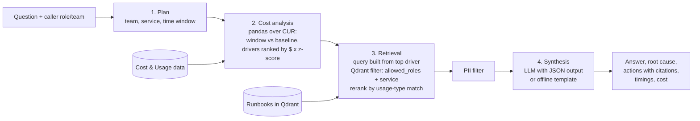

# AWS Cost Investigation Assistant

[](https://github.com/pritichaudhariii/aws-cost-investigation-assistant/actions/workflows/ci.yml)


Ask *"Why did the payments team's networking cost spike last week?"* and get back the resource that caused it, how
much it added per day, which runbook explains the pattern, and what to do about it, with citations.

The assistant is a **multi-stage RAG pipeline**: it first runs a structured analysis over AWS Cost & Usage data to find
*what* changed, then uses that finding to retrieve the right runbook from a **Qdrant** vector store (filtered by the
caller's role), and only then asks an LLM to write the explanation. Retrieved text goes through a **PII filter** before
it reaches the model or the user, and an **evaluation harness** measures accuracy, retrieval quality, latency, cost per
query and the security guardrails on every CI run.

```
$ costassist investigate --scenario S07 --role engineer
Q: data-platform Lambda costs exploded last week, can you find out why?

Daily spend went from $185.69 to $322.46 (+$136.77/day). The largest driver is AWSLambda `USE1-Lambda-GB-Second`
on `fn-data-platform-thumbnailer` in us-east-1: $0.00 -> $112.28 per day (+$112.28, new resource first seen 2026-09-25).
Smaller contributors: AmazonEC2 BoxUsage:m6i.xlarge (+$25/day). This pattern matches the runbook
"Lambda runaway or recursive invocations" [lambda_recursive_loop].

Recommended actions:
  - Write outputs to a different bucket or prefix and scope the trigger with a prefix/suffix filter. [lambda_recursive_loop]
  - Keep Lambda recursive loop detection enabled; set reserved concurrency as a safety cap. [lambda_recursive_loop]
  - Add a dead-letter queue and a maximum receive count. [lambda_recursive_loop]
```

## Pipeline



**Why multi-stage?** Embedding the raw question ("why did costs go up?") does not say *which* service or usage type
changed, so a single-stage retriever mostly guesses. Stage 2 finds the actual driver (for example
`USE1-NatGateway-Bytes` on `nat-payments-a`, +$250/day, brand-new), and stage 3 retrieves with that. The ablation below
shows the difference.

## Security and access control

| Control | How it is enforced |
|---|---|
| **Cost data isolation** | Engineers are scoped to their own team; asking about another team raises `AccessDenied` (HTTP 403). Finance and admin roles see all teams. |
| **Knowledge isolation** | Every chunk carries `allowed_roles`. The role filter is part of the **vector store query** (a Qdrant payload filter), so restricted chunks are never returned, rather than being filtered afterwards. Finance-only (commitments) and admin-only (escalation contacts) documents are included to test this. |
| **PII / secret filtering** | Emails, phone numbers, IPs, AWS access key IDs and secret-key-shaped strings are redacted from retrieved text *before* the LLM call and from the final answer. Redaction works on copies, so the stored documents are unchanged. |
| **Grounded output** | The LLM must answer in JSON with a root cause from a fixed category list; anything else falls back to the retriever's category. Invalid JSON falls back to the deterministic synthesizer. |
| **Auditable** | Every response includes sources, stage timings, LLM token cost and redaction counts. |

## Evaluation

`python -m evaluation.run_eval` runs 30 labelled scenarios (10 anomaly types x 3 variants with different teams,
regions, windows and magnitudes). Each scenario also injects **decoy growth** in an unrelated service so the analysis has
to rank drivers rather than pick whatever went up.

Results with the default offline configuration (hashing embedder, in-memory store, template synthesizer), as an
engineer (full table: [`evaluation/results.md`](evaluation/results.md)):

| Metric | Multi-stage (default) | Single-stage baseline (`--retrieval-mode question`) |
|---|---|---|
| Root-cause accuracy | 1.00 | 0.13 |
| Top driver identified | 1.00 | 1.00 |
| Retrieval hit@1 / hit@3 | 1.00 / 1.00 | 0.13 / 0.47 |
| MRR | 1.00 | 0.27 |
| Latency p50 / p95 | ~15 ms / ~20 ms | ~15 ms / ~21 ms |
| Role isolation violations | **0** | 0 |
| Cross-team requests blocked | 30 / 30 | 30 / 30 |
| PII leaks in output | **0** | 0 |

Read these numbers honestly: the scenarios are **synthetic** and the anomalies are clean step changes, so the
multi-stage pipeline finds all of them. The useful signals are (a) the gap to the single-stage baseline, (b) the
guardrail metrics, which must stay at zero, and (c) a regression test that fails the build if accuracy or guardrails drop.
With a hosted LLM enabled, latency and cost per query are dominated by the model call and are reported per query by the
same harness (`cost_per_query_usd`, priced from `LLM_PRICE_IN_PER_1M` / `LLM_PRICE_OUT_PER_1M`).

## Quick start

```bash
git clone https://github.com/pritichaudhariii/aws-cost-investigation-assistant && cd aws-cost-investigation-assistant
python -m venv .venv && source .venv/bin/activate
pip install -e ".[api,qdrant,dev]"

costassist scenarios                                   # list the 30 built-in scenarios
costassist investigate --scenario S01 --role engineer  # run one
costassist investigate "Why did payments' costs rise last week?" --scenario S04 --role engineer --team mobile
# -> access denied: engineers on 'mobile' cannot view cost data for 'payments'

make test   # unit + integration tests
make eval   # regenerate evaluation/results*.md
```

### With Qdrant and an LLM

```bash
docker compose up --build            # Qdrant + API on :8000
export LLM_BASE_URL=https://api.openai.com/v1 LLM_API_KEY=... LLM_MODEL=gpt-4o-mini
# or a local model:  export LLM_BASE_URL=http://localhost:11434/v1 LLM_MODEL=llama3.1

curl -s localhost:8000/investigate \
  -H 'X-User-Role: engineer' -H 'X-User-Team: payments' -H 'content-type: application/json' \
  -d '{"question": "Why did payments networking cost spike last week?"}' | jq '.root_cause, .answer'
```

Any OpenAI-compatible endpoint works for both chat and embeddings (`EMBEDDER=openai`), or use
`EMBEDDER=sentence-transformers` for a local semantic model.

### Your own cost data

Export Cost & Usage data (CUR 2.0 / Data Exports, or a Cost Explorer extract) to CSV or Parquet with the columns
`date, account_id, team, region, service, usage_type, resource_id, cost` (map `team` from your cost allocation tag) and run:

```bash
costassist investigate "Why did S3 spend go up in the last 10 days?" --cur my_cur.parquet --role finance
```

## Project layout

```
costassist/
  scenarios.py     synthetic CUR data + 30 labelled anomaly scenarios (with decoys)
  query.py         stage 1: question -> team, service hint, time window
  analysis.py      stage 2: window vs baseline, drivers ranked by $/day and z-score, new-resource detection
  knowledge.py     markdown runbooks -> front matter + section chunks
  embeddings.py    hashing (offline) | sentence-transformers | OpenAI-compatible
  vectorstore.py   in-memory | Qdrant, same role/service filter semantics
  pii.py           redaction of emails, phones, IPs, AWS keys
  llm.py           OpenAI-compatible chat client with token cost accounting
  pipeline.py      orchestration, access control, synthesis, timings
  cli.py, api.py
knowledge/         10 runbooks + 1 tagging policy + 2 restricted documents
evaluation/        run_eval.py and the latest results
tests/             unit, pipeline, guardrail, CLI, API and Qdrant integration tests
```

## Limitations and next steps

- Synthetic data. Next: replay real CUR exports and label past incidents to build a harder evaluation set.
- Stage 1 uses keyword rules; an LLM-based planner would handle vaguer questions ("why is our bill weird?").
- Role and team come from request headers and must be set by an authenticating gateway (for example, derived from
  verified JWT claims), never by the client.
- Add Cost Anomaly Detection and CloudTrail lookups as extra tools, so the assistant can name *who* created a resource.

## License

MIT
